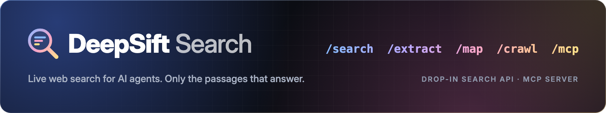

## What does DeepSift Search do?

DeepSift Search gives your AI agent live web search. You send one question; it searches Google and Yahoo at the same time, opens the
best pages, and returns **only the passages that answer the question**, ready to drop into an LLM prompt.

It speaks the **same request and response format as the Tavily API**. If your code already uses Tavily,
you can switch by changing one line: the base URL.

Use it three ways:

- 🔁 **As a Tavily drop-in**: point the Tavily SDK (or any HTTP client) at DeepSift's address
- 🤖 **As an MCP server**: add it to Claude, Cursor, Windsurf or any MCP client, and get `web_search`, `web_read`, `web_map` and `web_crawl` tools
- 📋 **As a normal Apify run**: paste a list of search queries, get a table of results

## Why use DeepSift Search?

- **Fewer tokens for your LLM.** You get the best few passages from each page, not whole pages of menus and cookie banners.
- **Switch in a minute.** Same paths (`/search`, `/extract`, `/crawl`, `/map`), same fields, same response shape as Tavily.
- **Pay per use, no subscription.** You pay per search on your Apify account. Failed searches are free.
- **Google and Yahoo results, merged.** Up-to-date pages, with country, language, date-range and website filters. If one search engine is slow or down, you still get the other's results.
- **AI-picked passages.** A small AI model reads each page and keeps the passages that best answer your question.
- **No extra API keys.** Your Apify token is the only key you need.

## How to use it as a Tavily drop-in

Your address is `https://aadstra--deepsift-search.apify.actor`. Use your [Apify API token](https://console.apify.com/settings/integrations) as the API key.

**Python (Tavily SDK)**

```python
from tavily import TavilyClient

client = TavilyClient(
    api_key="<YOUR_APIFY_TOKEN>",
    api_base_url="https://aadstra--deepsift-search.apify.actor",
)
result = client.search("who acquired Tavily in 2026", max_results=5)
for row in result["results"]:
    print(row["url"], row["content"])
```

**Any language (HTTP)**

```bash
curl -X POST https://aadstra--deepsift-search.apify.actor/search \
  -H "Authorization: Bearer <YOUR_APIFY_TOKEN>" \
  -H "Content-Type: application/json" \
  -d '{"query": "best open source vector database 2026", "max_results": 5}'
```

Supported endpoints:

| Endpoint | What it does |
|---|---|
| `POST /search` | Search Google and Yahoo; returns the best passages from each result page |
| `POST /extract` | Readable text of up to 20 pages or PDFs (optionally only the parts about a `query`) |
| `POST /crawl` | Reads many pages of one website; `instructions` keeps the relevant ones |
| `POST /map` | Lists a website's page addresses |

## How to use it as an MCP server

Add this to your MCP client's settings (Claude Code, Claude Desktop, Cursor and others):

```json
{
  "mcpServers": {
    "deepsift-search": {
      "url": "https://aadstra--deepsift-search.apify.actor/mcp",
      "headers": { "Authorization": "Bearer <YOUR_APIFY_TOKEN>" }
    }
  }
}
```

Your agent then has four tools: `web_search`, `web_read`, `web_map` and `web_crawl`.

## How to use it as a normal run

1. Click **Try for free**.
2. Type one search per line in **Search queries**.
3. Pick how many results you want and, if you like, a time range, country or website filter.
4. Click **Start**. Results appear in the **Output** tab and can be downloaded as JSON, CSV or Excel.

## Input

| Field | Meaning |
|---|---|
| `queries` | List of searches (required) |
| `searchDepth` | `basic` (best passage per page), `advanced` (up to three passages, longer page reads) or `fast` (search-engine snippets only) |
| `maxResults` | Results per search, 1 to 20 (default 5) |
| `topic` | `general`, `news` or `finance` |
| `timeRange` | `day`, `week`, `month` or `year` |
| `includeDomains` / `excludeDomains` | Only search, or never return, these websites |
| `country` / `language` | Two-letter codes, e.g. `us`, `in`, `de` / `en`, `hi` |
| `includeFullPages` | Also return each page's full readable text |

## Output

One row per result:

```json
{
  "query": "best open source vector database 2026",
  "rank": 1,
  "title": "The top open source vector databases & comparison",
  "url": "https://redis.io/blog/best-open-source-vector-databases-comparison/",
  "content": "The top open source vector databases & comparison · Redis · Milvus · Weaviate · Qdrant ...",
  "score": 0.93,
  "publishedDate": null
}
```

## How much does it cost?

You only pay for what you use. Prices per event:

| Event | Price |
|---|---|
| Search (basic or fast) | $0.004 ($4 per 1,000) |
| Advanced search | $0.008 ($8 per 1,000) |
| Page read (each page returned by `/extract` or `/crawl`) | $0.001 ($1 per 1,000) |
| Site map (each `/map` request) | $0.002 ($2 per 1,000) |

Platform usage is included: you pay only the prices above. Failed requests are not charged. You can set a maximum cost for each run, and DeepSift stops (and stops
charging) when it is reached.

For comparison, Tavily's published pay-as-you-go price is $0.008 per credit, and an advanced search uses two credits.

## Limits and good to know

- **No written answers or research reports.** `include_answer` returns `null` and `/research` is not available. DeepSift returns the sources; your own LLM writes the answer.
- **Speed.** The first request after a quiet period takes about 5 to 10 seconds while the server starts. After that, a search takes a few seconds (it opens and reads every result page). Repeating the same search within 24 hours is answered from a cache.
- **Pages that only show text after JavaScript runs** may come back thin.
- **Up to 20 results per search.** More than 10 reads a second Google results page.

## FAQ

**Is it legal to use?** DeepSift reads public web pages and Google and Yahoo results pages. You are responsible for how you use the
data. Don't use it to collect personal data without a legal basis (for example under GDPR).

**Is DeepSift open source?** Yes. The self-hosted version for your own computer is free on
[GitHub](https://github.com/pavanmulka/deepsift). This Apify version saves you from running and maintaining it yourself.

**I found a bug or need a feature.** Open an issue in the **Issues** tab. We usually reply within a few days.
